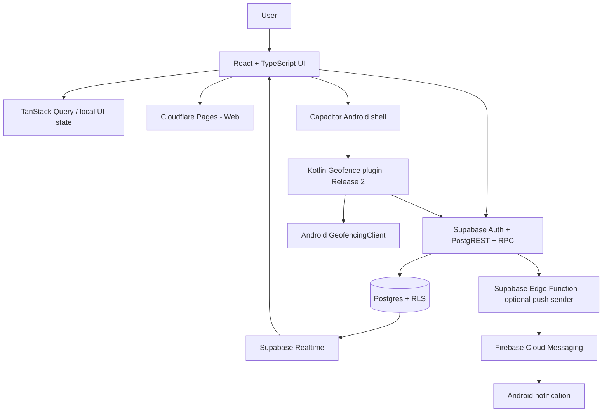

# 03 — System Architecture

## 1. Architecture overview

VAGASPOT is a web-first React application packaged for Android with Capacitor. Supabase is the single source of truth. Android-only functionality is isolated in a small Kotlin Capacitor plugin.



## 2. Runtime responsibility split

### Frontend (React)
- Authentication UI and OAuth redirect handling.
- Squad setup/join UI.
- Feed and member cards.
- Manual presence, availability and zone controls.
- Ghost Mode toggle.
- Notification settings UI.
- PWA manifest/service worker for static installability and safe app shell caching.
- No secrets beyond public Supabase URL and anon/publishable key.

### Supabase
- Google OAuth session and JWT.
- PostgreSQL storage.
- Row Level Security on all application tables.
- RPC functions for membership, invitations and presence mutations.
- Realtime feed synchronization.
- Optional Edge Function for Android FCM push delivery.
- No need for a separate Firebase Firestore or Firebase Functions backend.

### Capacitor / Android
- APK wrapper and app lifecycle/deep-link bridge.
- Release 2 native geofence registration and event receiver.
- Local pending event retry where network unavailable.
- Android notification permission and FCM token registration in push increment.
- No constant location service or periodic GPS polling.

### Cloudflare Pages
- Hosts Vite static build at a free `*.pages.dev` subdomain.
- No custom domain or paid Workers needed.
- Browser uses HTTPS for Geolocation and OAuth callbacks.

## 3. Recommended repository structure

```text
vagaspot/
  AGENTS.md
  README.md
  .env.example
  .gitignore
  package.json
  vite.config.ts
  tsconfig.json
  capacitor.config.ts
  public/
    manifest.webmanifest
    icons/
  src/
    app/                 # app bootstrap, routes, providers
    components/          # shared accessible UI primitives
    features/
      auth/
      squads/
      feed/
      presence/
      settings/
      notifications/
    lib/                 # supabase client, env validation, helpers
    hooks/
    styles/
    types/
    test/
  supabase/
    migrations/
    functions/
      send-presence-push/  # Release 1.1, optional
    seed.sql
  android/               # generated Capacitor Android project
    app/src/main/java/.../VagaGeofencePlugin.kt
    app/src/main/java/.../GeofenceReceiver.kt
  docs/                  # copy this pack into repository
```

## 4. State and data-fetching approach

- TanStack Query is the cache for server-owned data.
- Supabase Realtime events invalidate/refetch the relevant squad feed query. This avoids maintaining a complex parallel client-side state machine.
- Zustand is optional for ephemeral UI state only (active tab, dialogs, draft filters); do not duplicate server presence data there.
- On network reconnect, refetch authoritative state.
- On app resume, refetch feed and re-evaluate local expiry display.
- Do not cache other members' presence to disk longer than necessary; clear cached presence on logout and Ghost Mode changes.

## 5. Backend API contract (conceptual)

Prefer explicit database RPCs over raw client table updates for sensitive operations:

- `create_squad(name)` — creates squad and owner membership.
- `create_invite(squad_id, expires_in_hours)` — returns raw token once; stores only hash.
- `redeem_invite(raw_token)` — verifies expiry, revocation and use; creates membership.
- `get_my_squads()` — memberships for authenticated user.
- `get_squad_feed(squad_id)` — authorized member feed; hidden presence fields are redacted.
- `set_my_campus_state(squad_id, state, source)` — authenticated member only; source policy validated.
- `set_my_availability(squad_id, availability)` — sets expiry server-side.
- `set_my_zone(squad_id, zone_id, note)` — validates active zone and note size.
- `set_ghost_mode(squad_id, enabled)` — atomically hides/restores presence state according to BR-05.
- `set_notification_preferences(...)` — caller can edit only own preferences.
- `register_push_device(platform, token)` / `remove_push_device(token)` — authenticated owner only.

Exact SQL signatures must be aligned with `04_DATABASE_AND_PRESENCE_SPEC.md` before implementation. Do not expose unauthenticated update endpoints.

## 6. Realtime design

- Subscribe only while viewing an active squad.
- Subscribe to presence changes and relevant membership events, subject to RLS.
- Realtime is a signal to refetch; database state remains authoritative.
- On connection loss show last successful sync time and a reconnect state.
- Polling fallback can be 60 seconds while feed visible; pause polling when app is backgrounded. This is not a substitute for server freshness.
- Keep Realtime payloads small; never put coordinates, raw invite secrets or push credentials in channels.

## 7. Authentication and OAuth flow

- Supabase Auth Google provider.
- Create a Google OAuth web client in Google Cloud Console; use only basic `openid`, `email`, `profile` scopes.
- Configure authorized origins and redirect URLs in Google and Supabase.
- Web redirects back to HTTPS Pages URL.
- Android uses Capacitor Browser + App URL/deep-link handling (or a verified compatible native OAuth bridge); test OAuth callback on a physical device. Do not assume web redirect automatically returns to the app.
- During Google OAuth consent-screen testing, add the small friend group as test users if required by current Google project configuration.
- Never embed Google OAuth client secret in frontend.

## 8. Security architecture

- Enable RLS for every table accessible through Supabase APIs.
- RLS default deny. Membership helper functions must avoid recursive policy loops and use fixed `search_path` when security-definer is necessary.
- Direct writes to presence and membership tables are not granted to clients; use carefully validated RPCs.
- Users read only squads they belong to.
- Presence visibility is constrained by membership and Ghost Mode redaction.
- `service_role` and FCM service-account private key remain server-side secrets.
- Rate-limit invite redemption and account-level join attempts with database logic; no external paid rate-limiting product.
- Use Supabase App Security guidance and App Check-like controls if an appropriate free anti-abuse measure is available, but don't claim a client app attestation can replace RLS.

## 9. Reliability and degradation

- Realtime unavailable: show current data and poll/refetch fallback.
- Geolocation denied: manual campus-state selection remains available.
- Android geofence disabled: app functions manually.
- Edge Function/FCM unavailable: Realtime feed still updates; push is best-effort.
- Supabase paused/quota exhausted: show service unavailable; no paid failover is configured.
- Coordinate invalid or inaccurate: set/retain Unknown; never force On Campus/Off Campus from weak evidence.

## 10. Deployment environments

Only two environments are required for this project:

- Local development: one Supabase project and local `.env.local`.
- Pilot production: same Supabase project initially, Pages production branch and signed APK.

For a 6–10-user non-commercial pilot, a second staging Supabase project may not fit the account's Free project allowance if another project exists. Use local Supabase CLI/test database or a separate local schema for tests rather than assuming unlimited free projects.

## 11. Architecture decision on geofence shape

Android geofences are circular. The campus sign map outlines an irregular property boundary. In Release 2, use geofence circles only as coarse event triggers. On transition, obtain a fresh transient location and verify it against a manually validated polygon. Discard coordinates immediately. Multiple circles may be needed, but their placement/radius must be field-tested; a large single circle would incorrectly include nearby roads/properties. Do not claim polygon-perfect or instant boundary detection.
