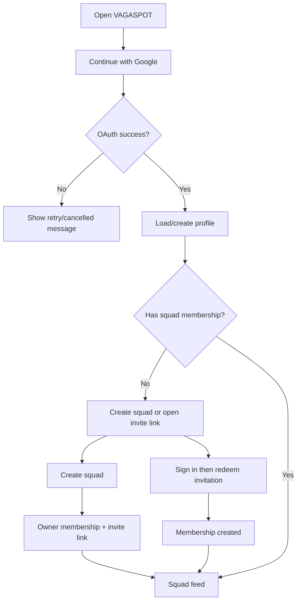
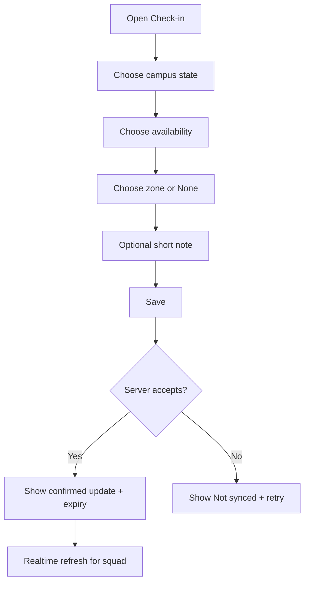
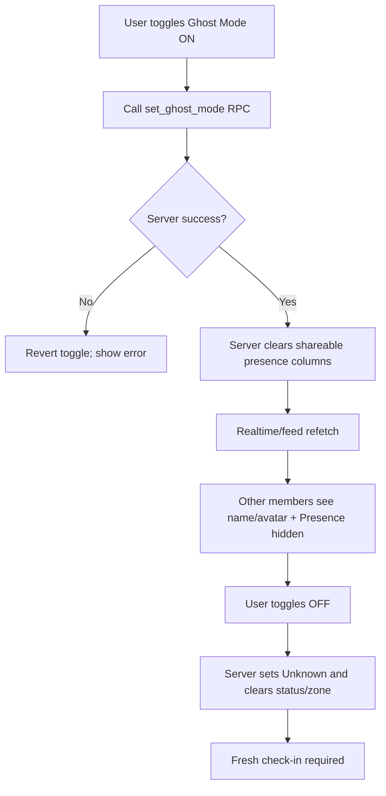
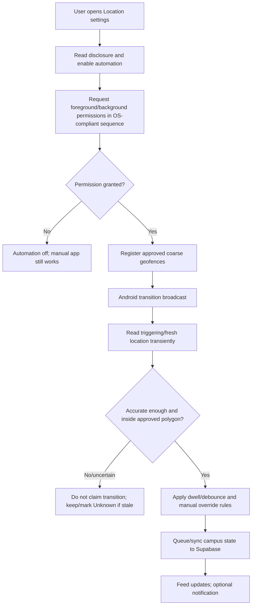

# 06 — User Flows

## 1. First-time sign-in and squad setup

## 2. Invite a friend

1. Owner opens Settings → Squad management → Invite friend.
2. Client calls `create_invite` RPC.
3. Backend generates a high-entropy one-use token, stores only hash and expiry, returns raw token once.
4. UI creates share link / QR code; token is not logged.
5. Friend opens link, signs in with Google if needed, then redeem RPC consumes token atomically.
6. Owner and members see the new member card. Notification is optional and later.

## 3. Manual check-in

The app computes display hints, but the database computes authoritative `updated_at` and expiry. If a user only changes campus state, do not modify availability/zone unless they explicitly choose those fields.

## 4. Ghost Mode

## 5. Campus status expiry

At feed read/render time:

1. If Ghost Mode, hide all presence fields.
2. If availability expiry is in the past, show no active availability and no active zone.
3. If campus freshness is past, show Unknown.
4. Never translate an expired or missing campus state into Off Campus.
5. On return to app / reconnect, refetch from server.

## 6. Release 2 Android geofence flow

## 7. Exit confirmation flow

- Candidate exit event arrives from Android. It is only a signal, not proof.
- Obtain one fresh location after the event where possible.
- If inside approved polygon, ignore candidate exit.
- If outside, wait a proposed 3 minutes (configurable) and perform one more location check.
- If still outside with acceptable reported accuracy, set Off Campus.
- If either check is unavailable, inaccurate or the phone is offline, keep last confirmed state until freshness cutoff; then show Unknown.
- A new candidate entry during grace cancels pending exit.
- Manual campus override takes precedence until `manual_override_until` or a new verified geofence event.

## 8. Web manual location flow

1. User explicitly taps “Check location” or “I'm on campus”.
2. Browser asks permission if needed.
3. Read one location fix over HTTPS.
4. If a verified polygon exists, the client may provide a convenience hint; authoritative validation should not trust client-side point-in-polygon alone for security-sensitive claims.
5. Send only campus state/source to RPC; do not store coordinates.
6. If geolocation is denied/unavailable, allow manual campus selection.

For MVP, even the one-time location button is optional; manual On Campus/Off Campus is sufficient.
